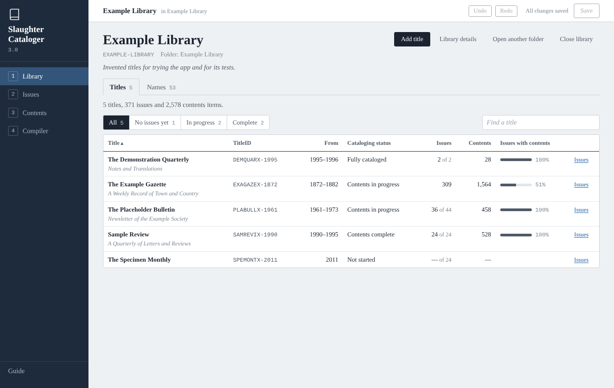
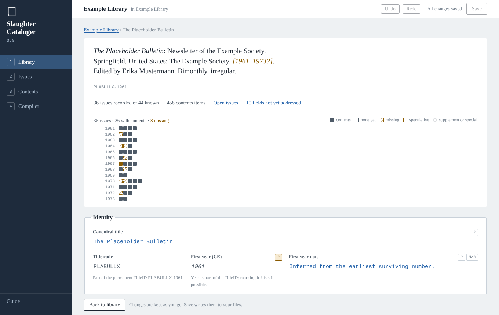
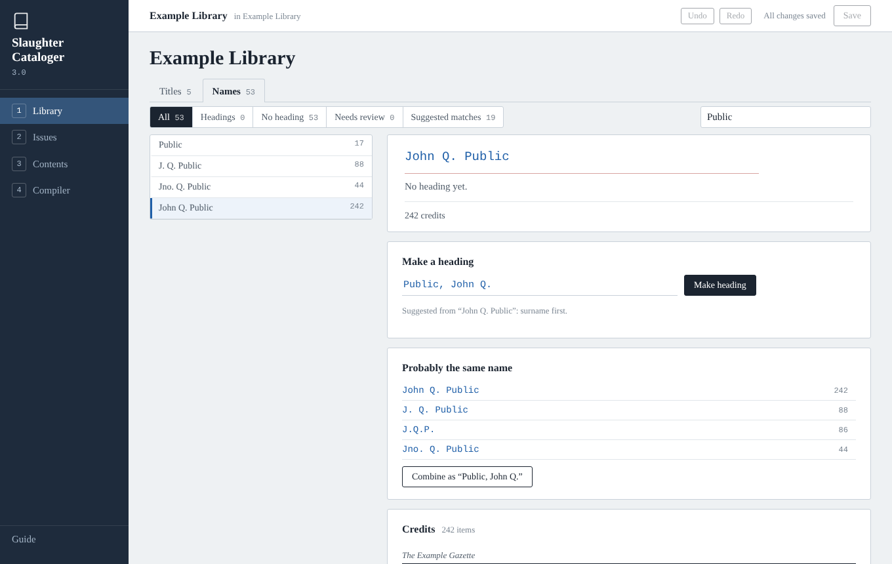
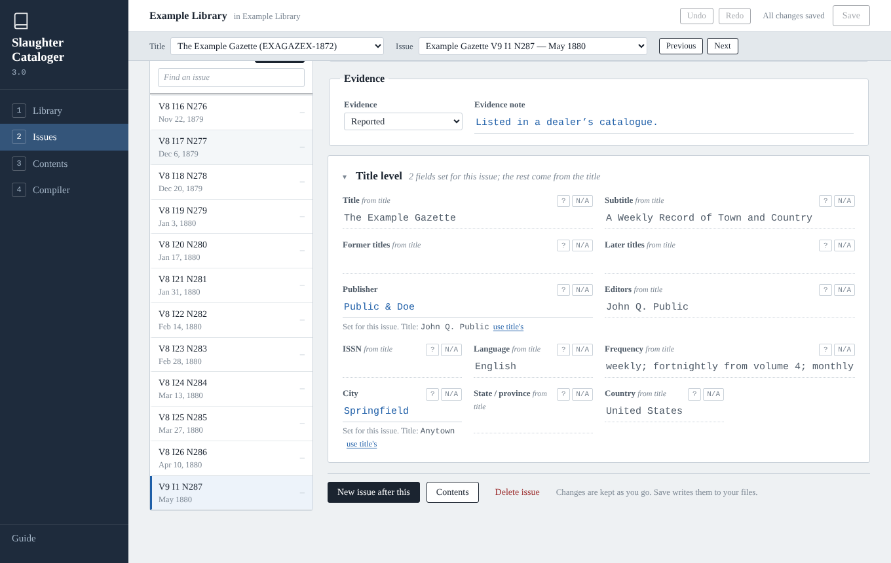
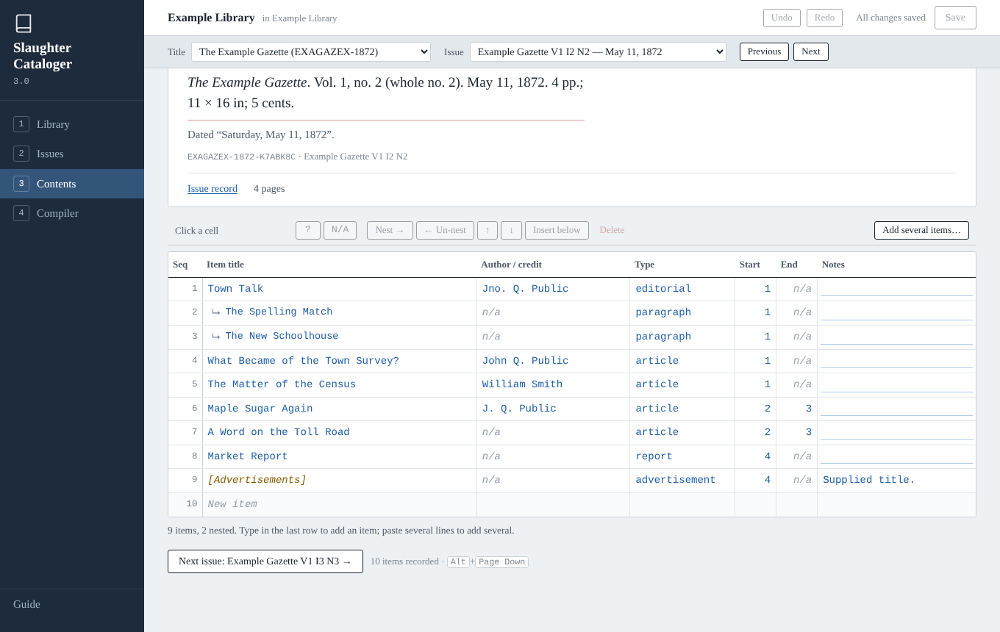
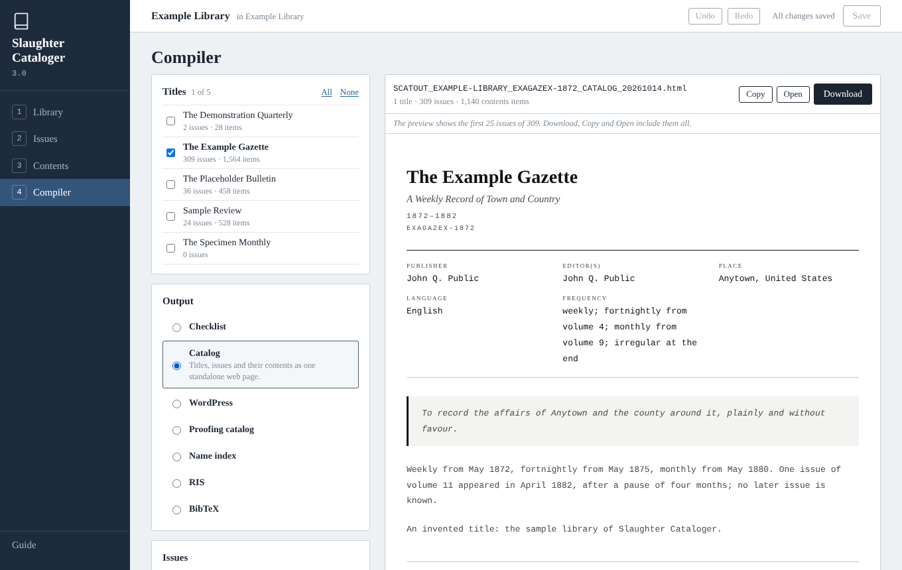

# Slaughter Cataloger

**A local-first browser app for cataloging serial publications.**

Build a structured, exportable bibliography of periodicals: newsletters, magazines, journals, newspapers, zines, bulletins, and anything else issued in numbered installments. Record each title, every issue, and what appears in each issue. Gather the different ways a person was credited under one heading. Compile checklists, catalogs, proofing sheets, name indexes and citation files.

Everything runs in your browser. Your catalog is a folder of plain CSV files that you own and can open in any spreadsheet. There is no account and no server, and no data leaves your machine.



---

## Getting started

1. **Get the app.** Download [`dist/slaughter-cataloger-3.html`](dist/slaughter-cataloger-3.html). It is one self-contained file and works offline. Alternatively, clone the repository and open `index.html`.
2. **Open it in Chrome or Edge** (desktop). See [browsers](#browsers) for the others.
3. **Start a new library** (pick an empty folder), or **Open library folder** to pick a folder of 3.0 CSV files.
4. Work through the four stages: **Library → Issues → Contents → Compiler**. The **Guide** at the bottom left of the app explains each one.

To try it without your own data, copy [`sample-data/3.0/example-library/`](sample-data/3.0/example-library/) somewhere and open that copy. It has five invented titles at different stages of cataloging ([what's in it](sample-data/README.md)). Saving writes into the folder you open.

Coming from Beta 2? See [Upgrading from Beta 2](#upgrading-from-beta-2). Version 3.0 doesn't open Beta 2 files directly.

---

## The four stages

**1 · Library.** Your titles, with their cataloging progress, and the title record editor. Each title page shows its run as a strip: one row per volume or year, one square per issue. Squares mark which issues have contents recorded, which are speculative or supplements, and which numbers are missing.



The **Names** tab gathers every credited name in the library. It suggests headings ("Public, John Q.") and finds forms that are probably the same person ("J.Q.P.", "Jno. Q. Public"). Headings never change the contents: each credit stays exactly as printed.



**2 · Issues.** Record issues one after another. A new issue follows on from the last one: its numbering, date and short name advance by the title's cadence, and you can change any of them. Issues inherit twelve title-level fields (publisher, editors, place, frequency and so on). An issue overrides a field only where it differs from the title. Gaps in a run are listed, and a run list sits beside the form.



**3 · Contents.** A spreadsheet-like grid per issue. You can:
- paste a table of contents (several lines at once, with tabs between columns);
- nest items under a section;
- reorder items;
- add several items at a time.

Authors and content types complete as you type.



**4 · Compiler.** Tick one title or several, choose an output, and see a live preview. Download, copy or open the whole output. The Compiler never writes into your library folder.

| Output | Format | For |
|---|---|---|
| Checklist | HTML, Markdown, plain text | the run as a list to tick off (plain, bibliographic, or IssueID first) |
| Catalog | standalone HTML | titles, issues and contents as one web page |
| WordPress | Gutenberg blocks | pasting the catalog into the WordPress code editor |
| Proofing catalog | printable HTML | checking the records against the issues in hand, one issue per page |
| Name index | HTML, Markdown, plain text | every credited name under its heading, with see-references |
| RIS | `.ris` | Zotero and other reference managers, one record per contents item |
| BibTeX | `.bib` | JabRef and LaTeX, one entry per contents item |

Output files are named `SCATOUT_<LIBRARY>[_<TITLEID>]_<TYPE>_<YYYYMMDD>.<ext>`.



**Search.** The box at the top of every stage searches the library that is open: its titles, issues, contents items and the names credited in them. Results come grouped as Titles, Issues, Contents and Names. Each one opens where it is edited; a contents item opens its issue with the item's row in view.
- Every word must match the same record, and the last word may be the start of one.
- `"a phrase"` matches those words in order.
- Filters: `title:`, `credit:`, `type:`, `year:`, `id:`, `note:` and `in:` (one periodical). `-word` leaves out what matches.
- Credits match however they are spaced or pointed (`J.Q. Public` finds `J. Q. Public`). A heading also brings in the items credited under its other forms.

Search only reads. It keeps its index in memory and never in a file or the browser's storage. It never searches the text of an issue, nor names merely mentioned in one. [docs/SEARCH.md](docs/SEARCH.md) has the details.

---

## Your data: a folder of CSV files

| File | Name |
|---|---|
| Titles (one per library) | `SCAT_<SLUG>_TITLES.csv` |
| Issues (one per title) | `SCAT_<SLUG>_<TITLEID>_ISSUES.csv` |
| Contents (one per title) | `SCAT_<SLUG>_<TITLEID>_CONTENTS.csv` |
| Name headings (one per library) | `SCAT_<SLUG>_AUTHORITIES.csv` |

A title's issues can also be split over more than one Issues file (made outside the app; the app keeps one per title). The run is then shown file by file, each file in its own Entry Order, and which file comes first follows the files' names: `…_ISSUES_2.csv` sorts before `…_ISSUES.csv`, so give the files names that sort in run order (`…_ISSUES_01.csv`, `…_ISSUES_02.csv`). The Library page names every such title, with its files in the order used and the issues each holds; nothing is reordered or changed. A new issue goes into the file of the issue it follows, right after it.

Every row names its tool, schema version (3.0) and library. Columns the app doesn't know are kept as they are. The files are UTF-8 text; when you save them from a spreadsheet, choose **CSV UTF-8** (in Excel, "CSV UTF-8 (Comma delimited)"), not plain "CSV".

**Permanent IDs.** Each ID is minted once and never changes:
- **TitleID:** `EXAGAZEX-1872`, an 8-character title code plus the first year (`189X` or `XXXX` for unknown digits). It is fixed once the title exists.
- **IssueID:** `EXAGAZEX-1872-K4R8V2M`, the TitleID, `K` and six random characters.
- **ContentID:** `EXAGAZEX-1872-CPW4JB6`, the TitleID, `C` and six random characters.
- **AuthorityID:** `AU-3FQ8MW`, `AU-` and six random characters.

The random part of each ID uses digits 2–9 and capital letters, without I, O, L, X, 0 or 1.

**Field states.** Every field is one of:
- filled;
- speculative, marked **?** (inferred, uncertain, or from a secondary source; shown as `[1872?]` in outputs);
- **N/A** (considered, and doesn't apply);
- unaddressed.

**Inheritance.** An Issues file holds every issue's effective values, so it reads correctly on its own in a spreadsheet. The `Overridden Fields` column lists which values the issue sets itself, rather than taking them from the title.

---

## Saving, backups and recovery

**Save writes into your folder** (Chrome and Edge). Only files that changed are written, and each keeps its own CSV layout (BOM, line endings, quoting), so a small edit makes a small difference. "All changes saved" means every file in the folder holds exactly what you see.

**Backups are automatic and never written over.**
- The first time a save replaces a file in a session, the version on disk is copied into `_backups/<date-time>-<code>/`, a folder of that session's own, inside your library folder.
- If a file was changed by something else while the library was open (a spreadsheet, say), that version is copied too, and the save tells you where.
- Each copy is the file's exact bytes, read back and checked before the file is replaced. If a copy can't be made, the file isn't saved, and the message says why.
- If you delete `_backups` while the app is open, the next save makes a new one.
- Each backup folder has a `BACKUPS.txt` listing what every copy is, when it was made and why.
- **To go back to an earlier version,** copy it from `_backups/…` into the library folder under its original name, then reopen the folder.

**The browser keeps a working copy.** Every change is also written into this browser's storage as you make it. If the tab closes, the browser crashes or the computer restarts, open the app again: your work is there, marked unsaved, and the app asks for access to the folder again (**Allow access**). Text typed in a field is part of that work once you leave the field or press Enter; until then, leaving or reloading the page asks first, as it does while files are unsaved. A new issue being entered is not part of it until you record it: once you have entered something in the draft, leaving or reloading the page asks first too. **Close library** and **Open another folder** ask before discarding unsaved changes or a new issue being entered (one question for both).

Two limits:
- A change made in the instant before a crash can be lost.
- Clearing the browser's data for the page deletes the working copy.

The working copy is not a backup, so save often. If the browser can't store a change, a red notice says so, and stays until the whole library has been stored again. If something couldn't be brought back after a crash, the app says so when it reopens.

**One tab at a time.** Only one tab works on the library. A second tab offers **Use this tab instead**; the first then stops, including any save in progress, so the two don't overwrite each other. (In a browser without the Web Locks API — older than Chrome 69, Firefox 96 or Safari 15.4 — a take-over at the very instant the first tab is replacing a file can still let that write land after the second tab's save.)

**When the folder changes while you are away.** On reconnecting, the app:
- reads files that were added;
- reads again the files you haven't changed;
- keeps your version of files you have changed. Saving them then backs up the version on disk first.

A file that has disappeared keeps its records in the app, and nothing is written to its name until it's back or you remove it on the Library page. If the remembered folder now holds a different library, the app reads nothing from it and writes nothing into it.

**Files and rows the app can't read** are never written over:
- **A whole file that is malformed** isn't loaded, and the load report gives the line. Examples: a quote never closed, a column heading used twice, a row with more or fewer values than the header. Adding records that would go into that file is refused until you correct it.
- **A file that isn't UTF-8** (a spreadsheet's plain "CSV", in a Windows code page) isn't loaded either: reading it as UTF-8 would damage its accented letters, and saving would make that permanent. Save it again as CSV UTF-8 and reconnect.
- **Single rows that can't be taken in** are set aside and written back exactly as they were. Examples: a repeated ID, another library's row, a row of the wrong kind. The Library page lists them.

### Spreadsheet safety, and editing the CSVs elsewhere

A value starting with `=`, `+`, `-` or `@` (or a tab) is written with an apostrophe in front, so a spreadsheet doesn't run it as a formula: `-- END` is stored as `'-- END`. The app removes the apostrophe when reading. A value that itself starts with an apostrophe before one of those characters gets one more (`''-ism`), so everything the app writes reads back exactly.

In a file edited elsewhere, the same rule applies, the way spreadsheets read it:

| In the CSV | Read as |
|---|---|
| `'-ism`, `'@handle`, `'=SUM(1,2)` | `-ism`, `@handle`, `=SUM(1,2)`: the apostrophe is the escape |
| `''-ism` | `'-ism`: type the apostrophe twice to keep a literal one |
| `=SUM(1,2)` | `=SUM(1,2)`, as it is; the app adds the apostrophe when it next saves the file |
| `'Twas`, `'quoted'` | exactly as written: an apostrophe before anything else is never touched |

---

## Browsers

| Browser | How saving works | Status |
|---|---|---|
| **Chrome, Edge** (desktop, version 123 or later) | Straight into your library folder, with backups | **Supported.** Tested automatically in Chromium |
| Other Chromium browsers (Brave, Opera, Vivaldi, Arc) | Usually the same; some turn folder access off | Not tested |
| **Firefox, Safari** | Load the CSV files (pick or drop them); Save downloads the changed files. They count as saved only once you click **I've replaced the files**, after moving the downloads into your library folder | **Not tested in those browsers.** The same code paths are tested in Chromium with folder access and tab locking switched off |
| Phones and tablets | | Not supported |

Fonts come from Google Fonts when online; offline, the app uses fallback fonts and works the same.

---

## Upgrading from Beta 2

Version 3.0 reads only schema 3.0 files. Convert a Beta 2 library once with the converter, which needs [Node.js](https://nodejs.org) 18 or later:

```sh
node tools/convert-to-3.js "path/to/beta 2 folder" --out "path/to/new folder"
```

The converter:
- reads every Beta 2 CSV under the folder. Your files are never modified.
- merges dated copies. Copies of a Titles or Issues list (files sharing record IDs) are merged record by record: the newest file, by its modification date, wins, and records found only in older copies go into a `_left-out/` folder. Contents are merged an issue at a time: each issue's contents come from the newest file that has any for it. Lists that share no IDs are separate, and all are used.
- writes one Titles file per library, and one Issues and one Contents file per title, under the standard names.
- gives every contents item a permanent ContentID and links nested items.
- turns Beta 2 name authority lists (`AUTHORITY_<TitleID>.csv`) into the library's Authorities file.
- verifies the result by reading it back with the 3.0 reader.
- writes `CONVERSION-REPORT.md`, listing every difference between copies and what was kept, and everything under the folder it did not convert (other files, folders whose names start with `_` or `.`, CSVs that are not Slaughter Cataloger files).

Each library is written into its own folder, `<out>/<SLUG>/` (for example `new folder/EXAMPLE-LIBRARY/`): open that folder in the app.

The converter never writes over anything:
- `--out` must be a folder that does not exist yet, outside the folder you convert.
- The result is written into a temporary folder beside it (`<out>.partial-…`), read back and checked there, and only then renamed to `--out`. If anything goes wrong, nothing appears at `--out`. A run that is killed can leave only that temporary folder, marked `INCOMPLETE.txt`; delete it.
- A file that is not UTF-8 (a spreadsheet's plain "CSV" rather than "CSV UTF-8"), or a Slaughter Cataloger file that cannot be read as it stands, stops the conversion with nothing written, and the file is named. Save it again as CSV UTF-8, or correct it, and run the converter again.

## Changing a TitleID

A TitleID is permanent. When one has to change, `tools/change-titleid.js` changes it everywhere: the title, the IssueIDs and ContentIDs (each keeps its own code under the new prefix), parent links, and the names of the title's files. It adds a dated sentence to the title's General Notes and lists any other text that still mentions the old ID.

```sh
node tools/change-titleid.js "path/to/library" OLDCODE-1872 NEWCODE-1872 --out "path/to/new folder"
```

Your library folder is only read, never written. The result is a new folder, made the same way as the converter's: `--out` must not exist yet and must be outside the library folder, and nothing appears there unless the whole result has been written and checked.

A file holding its header row only (what the app saves when the last record of a file is deleted) is read as the app reads it. An empty file of the library is carried into the new folder byte for byte, renamed with the title's other files if it is one of them; one the app would not load stops the change, as below.

It refuses, writing nothing:
- **A library with an `_issues/` folder** (installed issue packages): changing a TitleID inside packages is not supported yet.
- **A file that is not UTF-8,** or one the app would not load.
- **A file that would be renamed onto a name the folder already holds** (compared ignoring case, as on macOS and Windows disks): one file would take the other's place. The refusal names the file to move out.
- **Anything in the folder besides the catalog CSVs,** by default. The new folder holds the library's CSVs only, so other files (a README, `.DS_Store`), subfolders such as `_backups/`, and CSVs the app does not load (an older copy, say) would not be in it. The refusal lists each one. Move them somewhere safe and run again.

> **`--partial-copy`** makes the catalog-only copy anyway, on purpose. Every item it leaves out is listed in its report and in `PARTIAL-COPY.md` in the new folder. Those items are still in your library folder, which is never changed; nothing copies them for you. If a 3.0 folder also holds Beta 2 files, the app doesn't load them, says so on the Library page, and never changes them.

The Beta 2 apps remain in [`legacy/`](legacy/).

---

## Keyboard

| Keys | Does |
|---|---|
| Ctrl/⌘ + S | Save |
| Ctrl/⌘ + Z, Ctrl/⌘ + Shift + Z (or Ctrl + Y) | Undo, redo (every change, in any stage) |
| Ctrl/⌘ + Enter | Record the issue being drafted |
| Alt + Page Up / Page Down | Previous / next issue of the title (Issues and Contents), keeping the focus in the same field, or the same column of the first item |
| / | Go to the search box (when not typing in a field) |
| Enter, Tab (contents grid) | Move down, move right; take a completion |
| Alt + Shift + Delete (contents grid) | Delete the item (Undo brings it back). The forward Delete key: Fn + Delete on a Mac laptop |
| Arrow keys, Home, End | In the strip, the run beside an issue and the list of names: move from issue to issue (or name to name). Each is one stop for Tab |

---

## For developers

The app is plain JavaScript with [Preact](https://preactjs.com) and [htm](https://github.com/developit/htm), both vendored in `js/vendor/`. There is no build step and no npm install: `index.html` runs straight from the folder. `tools/build.py` inlines everything into the single file `dist/slaughter-cataloger-3.html`.

```
index.html            the app (loads css/ and js/)
js/core/              pure logic, also run by the tests in Node: schema, CSV, records, store,
                      numbering, contents, names, catalog view model, outputs, search; issue packages
                      (zipread.js, issuepkg.js: used by the tools, not yet by the app)
js/platform/          folder access, browser storage, locks, backups, downloads
js/app/session.js     opening, restoring, reconnecting, saving
js/ui/                the four stages and search (Preact + htm)
tools/                build, Beta 2 converter, TitleID migration, sample generators, issue-package
                      validator and staging converter, tests
sample-data/          five invented titles, used by the tests (3.0 and Beta 2), written by tools/make-sample.js;
                      issue-package/: invented issue packages (staging, native, booklet), by tools/make-issue-fixture.js
docs/                 ISSUE-PACKAGE.md (the issue-package format), SEARCH.md, SMOKE-TEST.md, screenshots/
dist/                 the single-file build
legacy/               the Beta 2 apps
```

`CLAUDE.md` holds the working notes: the architecture, and the decisions behind each mechanism.

### Tests

```sh
sh run-tests.sh                 # the release check: every suite, nothing may be skipped
sh run-tests.sh --quick         # Node suites only (a few seconds)
```

You need Node 18+ and Python 3. The browser suites need Playwright with Chromium (`npm i -g playwright && npx playwright install chromium`). The format checks install the parsers they use into a temporary folder. The browser walkthrough and the accessibility suite install axe-core there for their accessibility scans. If any check fails, or a required one can't run (Playwright missing, say), the script exits with status 1. The options that skip checks (`--no-browser`, `--offline`, `--quick`) exit with status 3, "not a release check". A skipped run is never reported as a pass.

| Suite | Checks |
|---|---|
| `test-numbering.js`, `test-store.js`, `test-names.js` | numbering, dates, short names, gaps, contents nesting and paste; undo/redo and changed-file revisions; credits, headings and matching |
| `test-hierarchy.js` | contents nesting where a part is separated from its parent by other items: Delete, Move, Nest, Un-nest and Insert below follow the actual parent links; no part ever comes before its parent; on ordinary nested lists (every sample issue, and thousands of random ones) the results are exactly the earlier ones; Catalog, WordPress and the proofing sheet name a separated part's parent |
| `test-outputs.js` | the catalog view model and every output, on the whole sample library |
| `test-safety.js` | CSV values and rows never dropped or changed; malformed files refused; nesting links; inheritance |
| `test-backups.js` | backups never written over and byte for byte, with a frozen clock and forced name collisions |
| `test-empty-files.js` | a file whose last record was deleted (its header row only): the app reads it back as an empty file of its kind, but only when its header row is exactly a 3.0 one and its name is this library's; every other header-only or foreign file stays refused; an empty file never stands in for a Titles or Authorities file with rows; `change-titleid.js` carries a valid empty file of the library into its output byte for byte (renamed with its title's files) and still refuses malformed, non-UTF-8 and zero-byte ones, files the app does not take in (unless `--partial-copy`, which lists them), a rename onto a name already in use, and the `--out` and `_issues/` cases; the converter lists header-only files as not converted, as before |
| `test-rewriting-tools.js` | the converter and `change-titleid.js`: their results unchanged; each refuses an output folder that exists or lies inside its input (also through a link), a file that is not UTF-8 or cannot be read as it stands, and (`change-titleid.js`) a library with `_issues/` or, without `--partial-copy`, anything it would not carry; a failure, a failed verification or a killed run leaves nothing at the output; the input is never written |
| `test-tool-paths.js` | tool paths no test had reached: a Beta 2 name authority list becomes the library's Authorities file (and one for a title no library holds is listed as not converted); a record found only in an older copy of a list is set aside, its original row in `_left-out/` and named in the report; the term scan's code, phrase and review terms, and its refusal of a term list inside the folder being scanned; the package validator's `--json` output |
| `test-roundtrip.js`, `convert-to-3.js` | Beta 2 → 3.0 conversion is lossless and verified |
| `make-sample.js --check` | the sample library is exactly what its generator writes, and its Beta 2 copy converts to its 3.0 copy |
| `test-issuepkg.js` | issue packages: the strict ZIP reader and validator refuse every kind of malformed or hostile package, each with its reason; staging packages convert without loss; page locations, unresolved identities and editorial brackets are checked; offsets agree with an independent Python reading |
| `make-issue-fixture.js` | the invented issue packages are exactly what their generator writes, and the twin's staging form converts to its native form |
| `test-search.js` | search:<br>• folding, the query language and ranking;<br>• golden results on the sample library;<br>• heading expansion;<br>• an index kept up through edits, undos and reloads that equals one built afresh;<br>• read-only;<br>• performance on a generated 10,000-item library: a 2-second limit, and the Phase 2 targets reported as diagnostics |
| `test-formats.js` | BibTeX, RIS and WordPress outputs read by Better BibTeX's parser, citation-js and Gutenberg's own parser |
| `test-walkthrough.js` | the app end to end in Chromium, including search:<br>• every kind of result opened, and Back;<br>• keyboard only;<br>• an edit and its undo;<br>• nothing changed or read by a search session;<br>• an issue package in the folder never opened;<br>• axe-core |
| `test-session.js` | saving, restoring, reconnecting, two tabs, crashes, failed writes, and the browser's real file API |
| `test-hierarchy-grid.js` | the Contents grid in Chromium on an issue whose parts are separated from their parent: what it shows, Delete (and its question), Move, Nest, Un-nest and Insert below, Undo and Redo, the parent of every item and the number of items after each step; then save, the saved files read back, a reload and a fresh open |
| `test-destructive.js` | Delete title, Delete issue, Delete heading and "New issue after this" in the middle of a run, in Chromium on an invented library: each question word for word, exactly which records change and that every other record is untouched, Undo and Redo, which files Save writes (the rest byte for byte) and their backups, the saved folder read back with the app's reader, and a fresh open. Emptied files are opened again and new records added to them; the library's only title cannot be deleted, and a Titles file with no title is never written. A title's run in two Issues files: a new issue at the beginning, where the files meet, in the middle and at the end goes next to the issue it follows, in that issue's file (DF-20) |
| `test-split-files.js` | Titles whose issues are in more than one Issues file, in Chromium on an invented library arranged in several ways (two and three files, names with and without the TitleID, two titles sharing a file): the Library page's warning word for word, its files in the order the run is shown, the same whichever order the folder lists the files, after a reload, a fresh open and when loaded as files; nothing changed by it (records, files, the load report); no warning for a run in one file, a file shared by two whole runs, or an emptied file beside a run (DF-22) |
| `test-undo-unsaved.js` | Keyboard Undo and Redo and unsaved work, in Chromium on an invented library: Ctrl/⌘ + Z, Ctrl/⌘ + Shift + Z and Ctrl/⌘ + Y on edits, Record issue, Delete issue, Contents cells and selects; the browser's own undo while typing in fields, cells and the search boxes, Escape; a field showing an undone value and writing nothing back (D-K1); leaving or reloading the page with unsaved files or uncommitted typing (D-K2), declined and accepted; Close library and Open another folder (the same folder, another library) declined and accepted; Ctrl/⌘ + S and Undo across a save; every step checked against the records, the marked files, the undo history, the browser's working copy and the folder byte for byte |
| `test-drafts.js` | A new issue entered and not recorded (K-D1), in Chromium on an invented library: no question for a draft only opened, ready after Record, changed back to what was proposed or changed only in its settings; a question before reloading or closing the page, Close library and Open another folder once something is entered, word for word and one question with unsaved files; declined, the draft and its values kept; agreed, a fresh draft; typing not yet left, Follows and Record; the records and the folder byte for byte throughout |
| `test-data-paths.js` | Reading, writing and library paths, in Chromium on an invented library: several versions of one file (the newest loaded, the other never written); extra columns kept on every row; a loaded file that stops reading cleanly (its records kept, the file not written unless changed here, then backed up first); permission refused on reconnecting and on saving (nothing read or written, the work kept); a download not confirmed ("Not yet"); a Contents file that was not loaded (nothing added under its name); contents of an issue missing from the Issues file; a Parent ContentID that cannot be used (kept; Nest replaces it; Undo brings it back); a new library refused in a folder of another library's files and made in one without them; renaming the library and editing its note; Title Code and First Year locked; a duplicate issue recorded beside the one it repeats; Roman short names rewritten in one step; rows set aside, shown and written back |
| `test-everyday.js` | Everyday features, in Chromium on an invented library: the stage rail, the context bar, Previous and Next, Alt+Page Up and Page Down, the Next issue link; a new issue's Follows (and its question), Start over, the draft kept per title, Keep it and Start again; the Moves on boxes, the date step and their remembered settings; months and seasons by click and Set end year; the "Make it vol. …" suggestion; a title missing from the Titles file (read only); Contents cells (? and N/A, Escape, Insert below, a pasted row); a new library (the form, without a folder); files dropped on the welcome page; a folder of Beta 2 files; adding a title (code and year checks); Names (filters, Find, Possibly the same, Add all, Find another form, Remove, Add to a heading, Suggested matches, a form under two headings); the Compiler (titles chosen and remembered, its notes, Copy, Open); Save while the folder is read; Entry Order missing or repeated |
| `test-minor-ui.js` | The smaller parts of the page, in Chromium on the sample library: the Compiler choosing a title named in the address, also once open; renaming the library marking only the files that carry its name, its note only the Titles file; Alt+Page Down and Up keeping the place; the load report shown and hidden; the Library list's filters with their counts, Find a title, and sorting by each column both ways (statuses in the order of the work); the count of fields not yet addressed and its go-to-first; the run beside an issue (its shared start, numbers missing, Find an issue); Shift+Enter in the grid; a name's credits (60, Show all); messages that clear themselves and notices that stay; the window title; a count and its verb agreeing |
| `test-performance.js` | The app at scale, in Chromium on two generated libraries of 10,000 contents items (50 titles with 2,000 headings; one title with a run of 2,000 issues): opening the folder, every stage, a change while each is shown, the Compiler with every title (each HTML output and RIS, previewed and downloaded whole), saving a few files and every file, the working copy, a reload, each within 2,000 ms; the Names list worked out once for each change and the same as search's own list; no short name checked again when nothing about it changed; the Compiler's preview divided among the titles chosen |
| `test-accessibility.js` | Accessibility, in Chromium on the sample library and an invented one: axe-core (every rule it runs by default: WCAG 2.0 to 2.2, A and AA, and its best practices) with no violation on every stage and the states within them; text inside fields at 4.5:1; one h1 on every view, columns and buttons named, no "&lt;" shown as text; no page scrolling sideways at 320 or 640 px, the bars scrolling with the page in a short window and placed under the top bar where it wraps; Tab and Shift+Tab through every view at three window sizes, each stop marked and none hidden beneath a bar; the keyboard alone in Library (Load CSV files, a new library's form, a title opened, the list sorted), Issues (the run and the strip as one Tab stop moved along with the arrow keys, a new issue recorded), Contents (an item typed, nested, deleted with Alt+Shift+Delete and brought back) and Names (a heading made, a match combined) |

GitHub Actions runs `run-tests.sh` on every push (`.github/workflows/tests.yml`).

**Before publishing,** run the release check with `SC_PRIVATE_TERMS` set to a list of terms that must not appear anywhere in the package (`SC_PRIVATE_TERMS=/path/to/terms.txt sh run-tests.sh`). The list lives outside the repository; `tools/scan-terms.js` describes its format. Every text file is scanned; images are listed as not scanned, so check them by eye.

**Two counts, one suite.** The term scan needs that list, so it can't run on GitHub:

| Where | Checks | Last line |
|---|---|---|
| GitHub Actions (no list) | 30 | "All 30 checks passed. Nothing skipped." and a note that the term scan did not run |
| Your computer, with `SC_PRIVATE_TERMS` set | 31 (the same 30, plus the term scan) | "All 31 checks passed, the term scan included. Nothing skipped. This is the release check." |

Both exit with status 0. Only the 31-check run clears a release.

**Search performance.** On a library of 10,000 contents items, building the search index for the first use and every search interaction must take under 2 seconds. A time over that limit fails the run. The earlier, tighter targets are still measured and reported, but never fail a run. These include a 300 ms first build on a mid-range laptop and 50 ms queries. The end of `run-tests.sh` lists every figure, met or NOT MET; on GitHub it also appears in the job summary. [docs/SEARCH.md](docs/SEARCH.md) §10 has the details.

**The app at scale.** The same 2-second limit holds for the rest of the app on two generated libraries of 10,000 contents items (50 titles with 2,000 headings, and one title with a run of 2,000 issues): opening the folder, every stage, a change while each is shown, the Compiler with every title, saving, the browser's working copy and a reload (`tools/test-performance.js`). Its figures are listed with search's.

To measure it on your computer, run this in the repository folder. It needs Node 18+, no browser, and about a minute:

```sh
node tools/test-search.js
```

It builds a generated library in memory: invented words, nothing written to disk. It times the first build in five fresh processes, then later builds, queries, updates and the names list. It prints every time with the machine's speed.

**Private acceptance of issue packages.** With `SC_PRIVATE_FIXTURE` set to a real staging package from the ingestion process (a .zip or folder kept outside the repository), one more check converts it in a temporary folder and proves the conversion lossless (`tools/test-issuepkg.js --private`). It prints counts and results, never text. It is for changes to the issue-package code and is not part of the release check.

---

## License

[MIT](LICENSE). The vendored [Preact](https://preactjs.com) (MIT) and [htm](https://github.com/developit/htm) (Apache 2.0) keep their own licenses; see [`js/vendor/NOTICE.md`](js/vendor/NOTICE.md).

## Status

**3.0** — October 2026. A ground-up rebuild of the Beta 2 suite as one app, reviewed for data safety before release.

## Release history

**3.0** — October 2026.
- **One app** instead of five, on one schema, one store and one view model for every output.
- **Saving straight into the library folder,** with automatic backups that are never written over and conflict detection.
- **A working copy in the browser,** with crash recovery; one tab at a time.
- **Issue drafting** with auto-advance.
- **Inherited title-level fields,** overridden only where an issue differs.
- **The contents grid,** with paste, nesting and completion.
- **Run strips** showing gaps.
- **Name headings,** with a library-wide name index.
- **New outputs:** BibTeX and the name index.
- **Permanent ContentIDs and AuthorityIDs.**
- **A one-time converter** from Beta 2.

**Beta 2.7** — 2026. The four apps combined into a single file (`legacy/beta-2.7/`).

**Beta 2.6** — July 2026. Titles dashboard for loading a library's Titles, Issues and Contents files together and viewing cataloging progress across all titles.

**Beta 2.5** — July 2026.
- New Compiler output modes: WordPress Catalog (native Gutenberg blocks), Proofing Catalog (print-optimised verification document), Full Catalog HTML.
- Volume/year grouping in all catalog outputs, and a scope panel for filtering by volume or year group.
- An active titles filter.
- A unified readiness function and full RIS cross-validation.

**Beta 2.0** — July 2026. Suite architecture: four apps (Titles, Issues, Contents, Compiler). IssueID permanent key system. Checklist and RIS outputs. Schema metadata in every CSV. Structured filenames. Formula injection protection.

**Beta 1.1** — July 8, 2026. Printer and Printer Location fields. Supplement/Special fixes. Import Replace/Append/Cancel.

**Beta 1.0** — July 6, 2026. Initial release.
